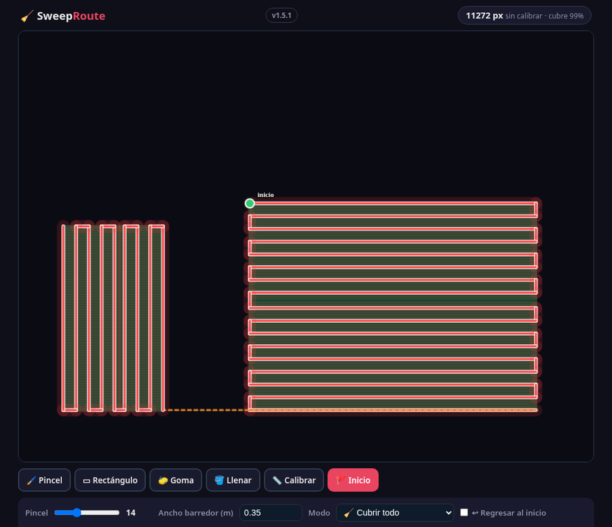

# 🧹 Sweep Route

> Pinta un plano y obtén la ruta de barrido más corta que cubre toda el área sin salirse de ella.

**[▶ Probar ahora](https://juliangdeveloper.github.io/sweep-route/)** · gratis, en el navegador, sin instalar

## Cómo se usa
1. Carga la imagen de un plano o usa el lienzo en blanco.
2. Calibra: traza una línea sobre una distancia conocida y escribe sus metros (sin calibrar, los resultados salen en píxeles).
3. Pinta las áreas transitables con pincel, rectángulo o llenar; lo que no pintes queda bloqueado.
4. Marca el inicio, define el ancho del barredor y, si quieres un circuito, activa "regresar al inicio".
5. Calcula en uno de tres modos: **Cubrir todo** (zigzag al ancho del barredor), **Sin repetir** (un solo trazado sin repasar zonas) o **Visitar zonas** (ruta corta que solo toca cada zona).
6. La ruta se anima sobre el plano con la longitud total. El proyecto se guarda solo en tu navegador.

## Cómo calcula
- El área pintada se vuelve una grilla; los caminos usan 8 direcciones sin cortar esquinas, con A* entre puntos y Dijkstra de fuente única entre zonas.
- Cubrir todo: franjas serpenteantes por componente conexo, con la orientación que minimiza giros.
- Visitar zonas: TSP aproximado (vecino más cercano + 2-opt).
- Solo las zonas sin camino interior se unen con un salto punteado.

## Stack
Un solo `index.html` con HTML, Canvas y JavaScript vanilla. Sin dependencias ni servidor.

---

Más proyectos: https://juliangdeveloper.github.io/

Hecho con ❤️ y 🧹
